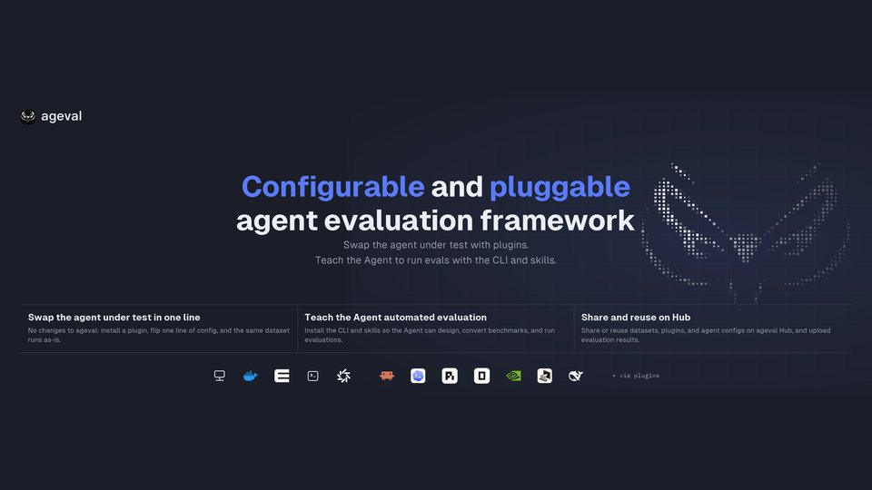
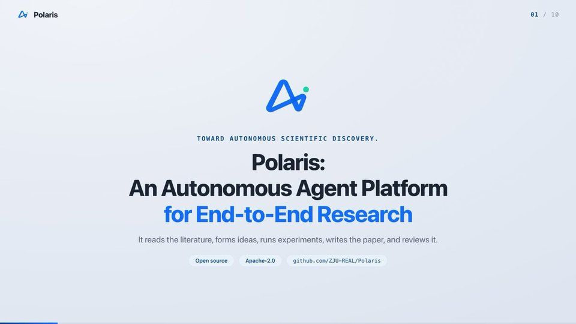
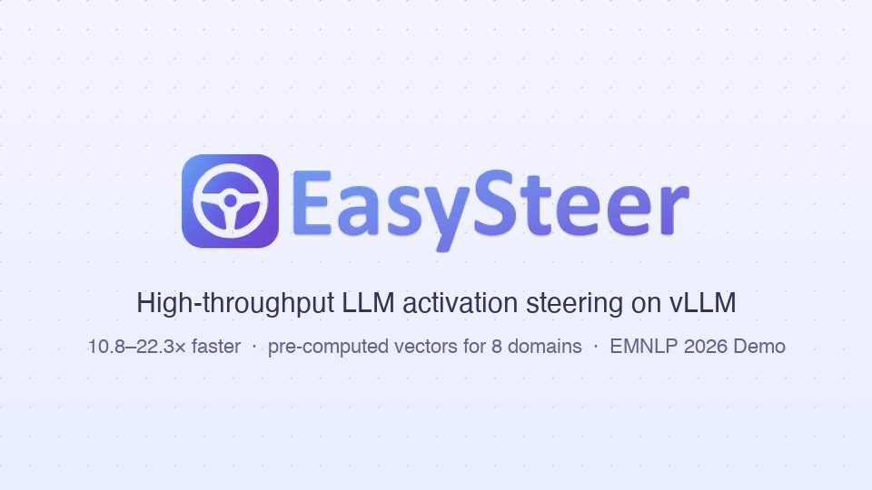
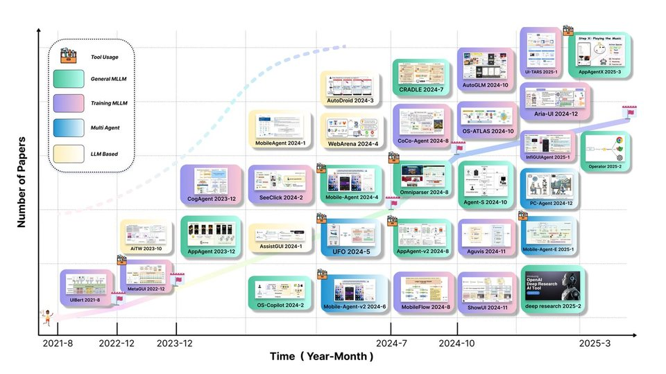

<picture>
  <source media="(prefers-color-scheme: dark)" srcset="assets/banner-dark.svg">
  
</picture>

  
  
  
  
   
  
  &nbsp;
  

**浙江大学 REAL 实验室** · 推理 · 具身 · 智能体 · 终身学习

We study one question from four sides: **what does it take for AI to work in the real world?** Our answer is a stack rather than a list of topics. A model first learns to **reason**, then to **perceive and model space**, then to **act** as an agent on screens, in software, and in the physical world, and finally to **keep growing** from the experience those actions produce. Each layer hands something concrete to the next, and a shared engine of agentic RL, self-distillation, and verifiable rewards runs through all of them.

<b>35+ papers in 2026</b> at ACL · EMNLP · ICML · ICLR · AAAI · CVPR · ECCV &nbsp;|&nbsp; <b>60+ open-source repositories</b>

## Flagship open source

<table>
<tr>
<td width="50%" valign="top">

<b><a href="https://github.com/ZJU-REAL/HugAgentOS">HugAgentOS</a></b> &nbsp;  
A self-evolving AgentOS. Memory, skills, and orchestration improve with every task, and each evolution step is attributable, replayable, and reversible.
</td>
<td width="50%" valign="top">

<b><a href="https://github.com/ZJU-REAL/Easel">Easel</a></b> &nbsp;  
An open-source social-media agent: discover trends, create posts, audio, and video, publish across platforms, and learn what actually works.
</td>
</tr>
<tr>
<td width="50%" valign="top">

<b><a href="https://github.com/microsoft/JARVIS">HuggingGPT</a></b> NeurIPS 2023 &nbsp;  
An LLM as controller and the Hugging Face hub as executors: plan, pick expert models, run them, and compose the answer.
</td>
<td width="50%" valign="top">

<b><a href="https://github.com/ZJU-REAL/ageval">ageval</a></b> &nbsp;  
Agent evaluation on one stable core. Swap the agent under test and its environment through plugins, and run the same dataset anywhere.
</td>
</tr>
<tr>
<td width="50%" valign="top">

<b><a href="https://github.com/ZJU-REAL/Polaris">Polaris</a></b> &nbsp;  
Autonomous end-to-end research: literature survey, ideas, experiments on real GPUs, paper writing, and review, as resumable human-gated runs.
</td>
<td width="50%" valign="top">

<b><a href="https://github.com/ZJU-REAL/ClawGUI">ClawGUI</a></b> &nbsp;  
Train, evaluate, and deploy GUI agents in one framework: online RL in parallel emulators and real Android, HarmonyOS, and iOS devices.
</td>
</tr>
<tr>
<td width="50%" valign="top">

<b><a href="https://github.com/ZJU-REAL/EasySteer">EasySteer</a></b> EMNLP 2026 Demo &nbsp;  
High-throughput LLM activation steering on vLLM, 10.8–22.3× faster than prior frameworks.
</td>
<td width="50%" valign="top">

<b><a href="https://github.com/ZJU-REAL/Awesome-GUI-Agents">Awesome-GUI-Agents</a></b> &nbsp;  
A curated map of GUI-agent research: training, grounding, datasets, and benchmarks, refreshed every conference cycle.
</td>
</tr>
</table>

## Research map

<picture>
  <source media="(prefers-color-scheme: dark)" srcset="assets/research-map-dark.svg">
  
</picture>

Read it bottom-up. Each layer builds on the one below it; filled boxes are open-source systems; the engine on the right is reused across all four layers.

## Research lines

### R · Reasoning: think longer, leaner, and verifiably

> **Frontier question.** How can a model reason over arbitrarily long horizons without drowning in its own context, stop once further thought stops paying off, and know when its answer is actually right?

| Step | Work | What it contributes |
| :-- | :-- | :-- |
| **Longer** | [InftyThink](https://github.com/ZJU-REAL/InftyThink) ICLR 2026 → [InftyThink+](https://github.com/ZJU-REAL/InftyThink-Plus) ICML 2026 | Interleaving reasoning with periodic summarization breaks the context-length ceiling; reinforcement learning then makes infinite-horizon reasoning effective and efficient. |
| **Leaner** | [Self-Braking Tuning](https://github.com/ZJU-REAL/Self-Braking-Tuning) NeurIPS 2025 · [LAPO](https://github.com/ZJU-REAL/LAPO) EMNLP 2026 · [Mind the Gap](https://github.com/ZJU-REAL/Mind-the-Gap) NeurIPS 2025 | Models learn to brake their own overthinking and fit reasoning length to difficulty, while bridged CoT data removes the thought leaps that make tuning brittle. |
| **Verified** | [VerifyBench](https://github.com/ZJU-REAL/VerifyBench) ICLR 2026 → [CoVerRL](https://github.com/ZJU-REAL/CoVerRL) ACL 2026 · [Pause or Fabricate?](https://github.com/ZJU-REAL/GRIL) ACL 2026 | Measure how reliable reward verifiers really are, then co-evolve generator and verifier so label-free training does not collapse into consensus, and teach models to stop instead of fabricate. |

**Hands up to the next layers:** verifiers and verifiable rewards become the training signal for spatial reasoning and agentic RL.

### E · Embodied: perceive, model, and predict space

> **Frontier question.** Can a vision-language model build a usable model of 3D space, reason from someone else's viewpoint, improve its spatial skill without human labels, and anticipate how a scene will change?

| Step | Work | What it contributes |
| :-- | :-- | :-- |
| **Measure** | [ViewSpatial-Bench](https://github.com/ZJU-REAL/ViewSpatial-Bench) ECCV 2026 | Multi-perspective localization exposes how poorly VLMs reason from viewpoints other than the camera's. |
| **Teach** | [SpatialLadder](https://github.com/ZJU-REAL/SpatialLadder) ICLR 2026 · [GPD](https://github.com/ZJU-REAL/GPD) | A progressive curriculum and distilled 3D privilege inject the spatial structure that 2D pretraining lacks. |
| **Self-evolve** | [SpatialEvo](https://github.com/ZJU-REAL/SpatialEvo) · [Spatial-Interactor](https://arxiv.org/abs/2609.23038) | Deterministic geometric environments and interaction with the physical world generate their own supervision. |
| **Predict** | [SpaceCast-Bench](https://github.com/ZJU-REAL/SpaceCast-Bench) · [WorldMemBench](https://github.com/ZJU-REAL/WorldMemBench) | From understanding the current scene to predictive spatial reasoning and the memory of video world models. |
| **Act** | [OmniEmbodied](https://github.com/ZJU-REAL/OmniEmbodied) | Embodied agents reasoning over physical interaction, tool use, and multi-agent coordination. |

**Hands up:** grounded perception is what lets agents act reliably on screens and in the physical world.

### A · Agentic I: computer-use agents

> **Frontier question.** How do we get from "click the right pixel" to agents that operate real devices over long horizons, mix GUI and command line, and keep improving while they work?

| Step | Work | What it contributes |
| :-- | :-- | :-- |
| **Ground** | [GUI-G²](https://github.com/ZJU-REAL/GUI-G2) AAAI 2026 → [GUI-RCPO](https://github.com/ZJU-REAL/GUI-RCPO) AAAI 2026 · [Reliable Negatives](https://github.com/ZJU-REAL/CANL) ECCV 2026 · [UI-Zoomer](https://github.com/ZJU-REAL/UI-Zoomer) | Gaussian rewards, test-time RL, confidence-anchored adaptation, and uncertainty-driven zoom make grounding precise, even without labels. |
| **Act** | [UI-S1](https://github.com/X-PLUG/MobileAgent/tree/main/UI-S1) ACL 2026 · [EMPO](https://aclanthology.org/2026.acl-long.428/) ACL 2026 · [UI-Copilot](https://github.com/ZJU-REAL/UI-Copilot) ACL 2026 | Semi-online and experience-driven multi-turn RL, plus tool-integrated policy optimization for long-horizon tasks. |
| **Beyond the GUI** | [HybridCUA](https://github.com/ZJU-REAL/HybridCUA) · [ComputerSD](https://github.com/ZJU-REAL/ComputerSD) · [Reflect, Revise, Reuse](https://arxiv.org/abs/2609.17653) | Orchestrate GUI and CLI together, self-distill online from real-time feedback, and evolve skills without retraining. |
| **Evaluate & deploy** | [KnowU-Bench](https://github.com/ZJU-REAL/KnowU-Bench) → **[ClawGUI](https://github.com/ZJU-REAL/ClawGUI)** | Interactive, proactive, personalized evaluation, and one framework to train, evaluate, and deploy agents on real phones. |

### A · Agentic II: research and creation agents

> **Frontier question.** Can an agent carry knowledge work end to end: search the open web, synthesize evidence, plan research, run the experiments, write it up, and learn from how its output lands?

| Step | Work | What it contributes |
| :-- | :-- | :-- |
| **Search & synthesize** | [IterSynth](https://arxiv.org/abs/2609.29444) EMNLP 2026 · [BrowserForge](https://arxiv.org/abs/2608.24848) · [EviNote-RAG](https://arxiv.org/abs/2509.00877) EMNLP 2026 | Role-decoupled deep search, parallel browser sandboxes that scale web episodes, and evidence notes for faithful retrieval-augmented answers. |
| **Build** | [Code-A1](https://github.com/ZJU-REAL/Code-A1) EMNLP 2026 | A code LLM and a test LLM co-evolve adversarially through reinforcement learning. |
| **Plan & discover** | [PaperGym](https://github.com/ZJU-REAL/PaperGym) → **[Polaris](https://github.com/ZJU-REAL/Polaris)** | Rubric-centered research planning, then an autonomous platform that goes from literature to a reviewed paper. |
| **Create & learn** | **[Easel](https://github.com/ZJU-REAL/Easel)** | A creator agent that discovers, plans, produces, publishes, and feeds performance back into its account profile. |

**Hands up:** every trajectory these agents produce becomes experience for the lifelong layer.

### L · Lifelong: from experience to skills to weights

> **Frontier question.** How should an agent turn its own experience into lasting capability, first as guidance, then as reusable skills, and finally as updated weights, while keeping every change reliable and auditable?

| Step | Work | What it contributes |
| :-- | :-- | :-- |
| **Guide** | [Agent-G²](https://github.com/ZJU-REAL/Agent-G2) EMNLP 2026 · [BEACON](https://github.com/ZJU-REAL/BEACON) ICML 2026 | Gaussian guidance over hint depth and milestone-guided learning densify the sparse rewards of long-horizon agentic RL. |
| **Internalize** | [SKILL0](https://github.com/ZJU-REAL/SkillZero) EMNLP 2026 · [ViSkill](https://github.com/ZJU-REAL/ViSkill) · [SkillRise](https://arxiv.org/abs/2607.26784) | Skills discovered in context are internalized into the policy, made visual-native, and carried across tasks. |
| **Distill** | [SDAR](https://github.com/ZJU-REAL/SDAR) → [AgentOPSD](https://arxiv.org/abs/2608.05987) · [Pass the Baton](https://github.com/ZJU-REAL/Relay-OPD) · [RetireOPD](https://arxiv.org/abs/2609.20784) | The first open-source framework that unifies agentic RL with on-policy self-distillation, and the family of methods built on it. |
| **Operate** | **[HugAgentOS](https://github.com/ZJU-REAL/HugAgentOS)** | Lifelong learning as a running system: memory, skills, and orchestration evolve with use, and each step can be attributed, replayed, and rolled back. |

### Shared engine

One toolkit runs through all four layers, so a gain in one place compounds everywhere else.

- **Agentic RL and self-distillation:** SDAR and its family, ComputerSD, Code-A1
- **Verifiable rewards:** VerifyBench, CoVerRL, GUI-G²
- **Test-time learning:** [TTPO](https://github.com/ZJU-REAL/TTPO), GUI-RCPO
- **Evaluation:** [ageval](https://github.com/ZJU-REAL/ageval), KnowU-Bench, ViewSpatial-Bench
- **Steering:** [EasySteer](https://github.com/ZJU-REAL/EasySteer) EMNLP 2026 Demo
- **Roots:** [HuggingGPT](https://github.com/microsoft/JARVIS) NeurIPS 2023 and [TaskBench](https://github.com/microsoft/JARVIS/tree/main/taskbench) NeurIPS 2024, where our agent line began with LLMs as controllers of models and tools

## Join us

We are continuously recruiting master's students, PhD students, and research interns through the **School of Software Technology**, the **School of Artificial Intelligence**, and the **College of Computer Science and Technology** at Zhejiang University. If you want to explore the frontiers of intelligence with us, see [how to apply](https://zju-real.github.io/join.html) or write to syl [AT] zju.edu.cn.

 
If our work helps you, a ⭐ on the repository helps others find it too.
  

