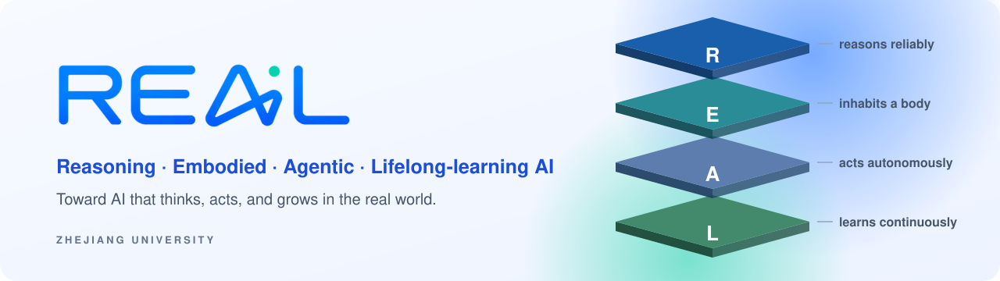
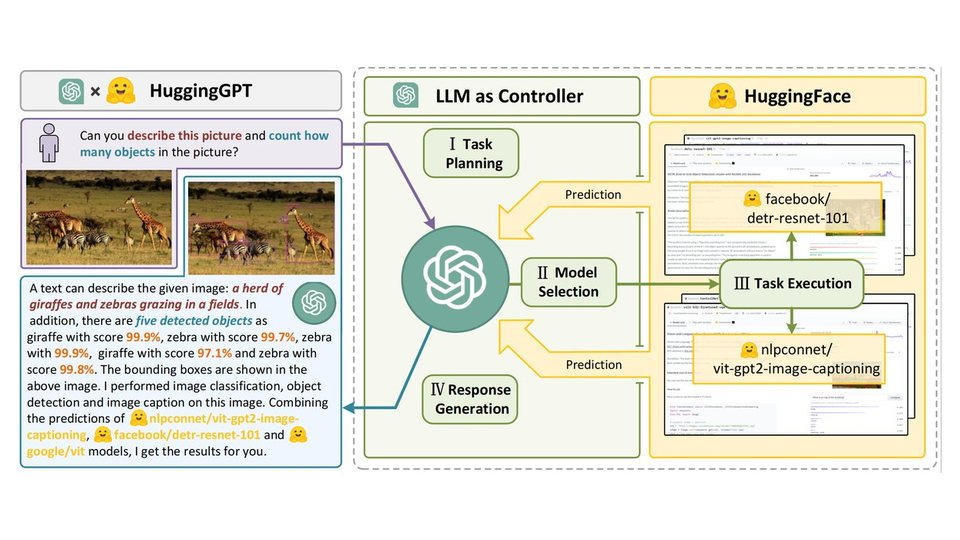
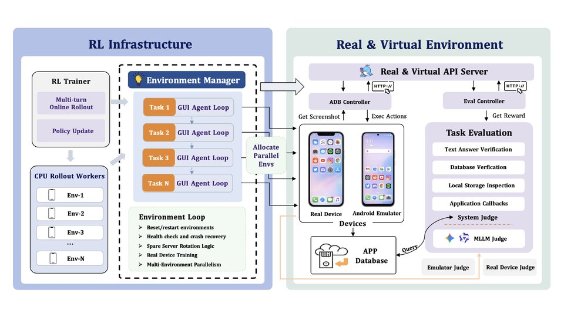

<picture>
  <source media="(prefers-color-scheme: dark)" srcset="assets/banner-dark.svg">
  
</picture>

  
  
  
   
  
  &nbsp;
  

**浙江大学 REAL 实验室** · 推理 · 具身 · 智能体 · RSI

We study one question from four sides: **what does it take for AI to work in the real world?** It has to **reason reliably**, **inhabit physical bodies**, **act autonomously** as agents, and **learn continuously** throughout its lifetime. These capabilities feed one another rather than standing alone.

## Open-source systems

<table>
<tr>
<td width="50%" valign="top">

<b><a href="https://github.com/microsoft/JARVIS">HuggingGPT</a></b> &nbsp;  
An LLM as controller and the Hugging Face hub as executors: plan, pick expert models, run them, and compose the answer.
</td>
<td width="50%" valign="top">

<b><a href="https://github.com/ZJU-REAL/HugAgentOS">HugAgentOS</a></b> &nbsp;  
A self-evolving AgentOS. Memory, skills, and orchestration improve with every task, and each evolution step is attributable, replayable, and reversible.
</td>
</tr>
<tr>
<td width="50%" valign="top">

<b><a href="https://github.com/ZJU-REAL/Easel">Easel</a></b> &nbsp;  
An open-source social-media agent: discover trends, create posts, audio, and video, publish across platforms, and learn what actually works.
</td>
<td width="50%" valign="top">

<b><a href="https://github.com/ZJU-REAL/ClawGUI">ClawGUI</a></b> &nbsp;  
Train, evaluate, and deploy GUI agents in one framework: online RL across parallel emulators and real Android, HarmonyOS, and iOS devices.
</td>
</tr>
</table>

<a href="https://zju-real.github.io/projects.html"><b>More projects →</b></a>

## Research map

<picture>
  <source media="(prefers-color-scheme: dark)" srcset="assets/research-map-dark.svg">
  
</picture>

Four capabilities, one loop around the real world: each hands something to the next, and every interaction flows back into a better model.

## Research lines

### R · Reasoning: think longer, leaner, and verifiably

> **Frontier question.** How can a model reason over arbitrarily long horizons without drowning in its own context, stop once further thought stops paying off, and know when its answer is actually right?

| Step | Work | What it contributes |
| :-- | :-- | :-- |
| **Longer** | [InftyThink](https://github.com/ZJU-REAL/InftyThink) → [InftyThink+](https://github.com/ZJU-REAL/InftyThink-Plus) | Interleaving reasoning with periodic summarization breaks the context-length ceiling; reinforcement learning then makes infinite-horizon reasoning effective and efficient. |
| **Leaner** | [Self-Braking Tuning](https://github.com/ZJU-REAL/Self-Braking-Tuning) · [LAPO](https://github.com/ZJU-REAL/LAPO) · [Mind the Gap](https://github.com/ZJU-REAL/Mind-the-Gap) | Models learn to brake their own overthinking and fit reasoning length to difficulty, while bridged CoT data removes the thought leaps that make tuning brittle. |
| **Verified** | [VerifyBench](https://github.com/ZJU-REAL/VerifyBench) → [CoVerRL](https://github.com/ZJU-REAL/CoVerRL) · [Pause or Fabricate?](https://github.com/ZJU-REAL/GRIL) | Measure how reliable reward verifiers really are, then co-evolve generator and verifier so label-free training does not collapse into consensus, and teach models to stop instead of fabricate. |

**Hands up to the next layers:** verifiers and verifiable rewards become the training signal for spatial reasoning and agentic RL.

### E · Embodied: sense, predict, and act in the physical world

> **Frontier question.** How does intelligence leave the screen? A model has to perceive 3D space from any viewpoint, keep improving that perception without human labels, anticipate how the world will change, and turn all of it into reliable physical action.

| Step | Work | What it contributes |
| :-- | :-- | :-- |
| **Perceive** | [ViewSpatial-Bench](https://github.com/ZJU-REAL/ViewSpatial-Bench) · [SpatialLadder](https://github.com/ZJU-REAL/SpatialLadder) · [GPD](https://github.com/ZJU-REAL/GPD) | Measure and teach the 3D spatial understanding that 2D pretraining lacks, including reasoning from viewpoints other than the camera's. |
| **Self-evolve** | [SpatialEvo](https://github.com/ZJU-REAL/SpatialEvo) · [Spatial-Interactor](https://arxiv.org/abs/2609.23038) | Geometric environments and interaction with the physical world generate their own supervision, so spatial skill keeps improving without human labels. |
| **Predict** | [SpaceCast-Bench](https://github.com/ZJU-REAL/SpaceCast-Bench) · [WorldMemBench](https://github.com/ZJU-REAL/WorldMemBench) | From the current scene to what happens next: predictive spatial reasoning and the memory of video world models. |
| **Act** | [VLA-Corrector](https://arxiv.org/abs/2607.01804) · [OmniEmbodied](https://github.com/ZJU-REAL/OmniEmbodied) | Close the loop to action: vision-language-action policies that detect and correct their own mistakes at inference time, and embodied agents that coordinate physical interaction and tool use. |

**Hands up:** grounding in the physical world is what lets agents act reliably beyond the screen.

### A · Agentic I: computer-use agents

> **Frontier question.** How do we get from "click the right pixel" to agents that operate real devices over long horizons, mix GUI and command line, and keep improving while they work?

| Step | Work | What it contributes |
| :-- | :-- | :-- |
| **Ground** | [GUI-G²](https://github.com/ZJU-REAL/GUI-G2) → [GUI-RCPO](https://github.com/ZJU-REAL/GUI-RCPO) · [Reliable Negatives](https://github.com/ZJU-REAL/CANL) · [UI-Zoomer](https://github.com/ZJU-REAL/UI-Zoomer) | Gaussian rewards, test-time RL, confidence-anchored adaptation, and uncertainty-driven zoom make grounding precise, even without labels. |
| **Act** | [UI-S1](https://github.com/X-PLUG/MobileAgent/tree/main/UI-S1) · [EMPO](https://aclanthology.org/2026.acl-long.428/) · [UI-Copilot](https://github.com/ZJU-REAL/UI-Copilot) | Semi-online and experience-driven multi-turn RL, plus tool-integrated policy optimization for long-horizon tasks. |
| **Beyond the GUI** | [HybridCUA](https://github.com/ZJU-REAL/HybridCUA) · [ComputerSD](https://github.com/ZJU-REAL/ComputerSD) · [Reflect, Revise, Reuse](https://arxiv.org/abs/2609.17653) | Orchestrate GUI and CLI together, self-distill online from real-time feedback, and evolve skills without retraining. |
| **Evaluate & deploy** | [KnowU-Bench](https://github.com/ZJU-REAL/KnowU-Bench) · **[ageval](https://github.com/ZJU-REAL/ageval)** → **[ClawGUI](https://github.com/ZJU-REAL/ClawGUI)** | Interactive, proactive, personalized evaluation, a plug-in harness that runs any agent on any environment, and one framework to train, evaluate, and deploy agents on real phones. |

### A · Agentic II: research and creation agents

> **Frontier question.** Can an agent carry knowledge work end to end: search the open web, synthesize evidence, plan research, run the experiments, write it up, and learn from how its output lands?

| Step | Work | What it contributes |
| :-- | :-- | :-- |
| **Orchestrate** | **[HuggingGPT](https://github.com/microsoft/JARVIS)** · [TaskBench](https://github.com/microsoft/JARVIS/tree/main/taskbench) | An LLM as controller that plans, calls expert models and tools, and composes the result, plus a benchmark for task automation: where our agent line began. |
| **Search & synthesize** | [IterSynth](https://arxiv.org/abs/2609.29444) · [BrowserForge](https://arxiv.org/abs/2608.24848) · [EviNote-RAG](https://arxiv.org/abs/2509.00877) | Role-decoupled deep search, parallel browser sandboxes that scale web episodes, and evidence notes for faithful retrieval-augmented answers. |
| **Build** | [Code-A1](https://github.com/ZJU-REAL/Code-A1) | A code LLM and a test LLM co-evolve adversarially through reinforcement learning. |
| **Plan & discover** | [PaperGym](https://github.com/ZJU-REAL/PaperGym) → **[Polaris](https://github.com/ZJU-REAL/Polaris)** | Rubric-centered research planning, then an autonomous platform that goes from literature to a reviewed paper. |
| **Create & learn** | **[Easel](https://github.com/ZJU-REAL/Easel)** | A creator agent that discovers, plans, produces, publishes, and feeds performance back into its account profile. |

**Hands up:** every trajectory these agents produce becomes experience for the lifelong layer.

### L · Lifelong: from experience to skills to weights

> **Frontier question.** How should an agent turn its own experience into lasting capability, first as guidance, then as reusable skills, and finally as updated weights, while keeping every change reliable and auditable?

| Step | Work | What it contributes |
| :-- | :-- | :-- |
| **Guide** | [Agent-G²](https://github.com/ZJU-REAL/Agent-G2) · [BEACON](https://github.com/ZJU-REAL/BEACON) | Gaussian guidance over hint depth and milestone-guided learning densify the sparse rewards of long-horizon agentic RL. |
| **Internalize** | [SKILL0](https://github.com/ZJU-REAL/SkillZero) · [ViSkill](https://github.com/ZJU-REAL/ViSkill) · [SkillRise](https://arxiv.org/abs/2607.26784) | Skills discovered in context are internalized into the policy, made visual-native, and carried across tasks. |
| **Distill** | [SDAR](https://github.com/ZJU-REAL/SDAR) → [AgentOPSD](https://arxiv.org/abs/2608.05987) · [Pass the Baton](https://github.com/ZJU-REAL/Relay-OPD) · [RetireOPD](https://arxiv.org/abs/2609.20784) | The first open-source framework that unifies agentic RL with on-policy self-distillation, and the family of methods built on it. |
| **Steer** | **[EasySteer](https://github.com/ZJU-REAL/EasySteer)** | Adjust a deployed model's behavior at inference time without retraining, through high-throughput activation steering. |
| **Operate** | **[HugAgentOS](https://github.com/ZJU-REAL/HugAgentOS)** | Lifelong learning as a running system: memory, skills, and orchestration evolve with use, and each step can be attributed, replayed, and rolled back. |

 
If our work helps you, a ⭐ on the repository helps others find it too.
  

